<h3><code>nishant@github ~ $ ./contributions.sh</code></h3>

  

<h3><code>nishant@github ~ $ whoami</code></h3>
<table>
  <tr>
    <td valign="top"></td>
    <td valign="top"></td>
  </tr>
</table>

 

<h3><code>nishant@github ~ $ ls projects/</code></h3>

| Project | What it is |
|---|---|
| [**ResumeIQ**](https://github.com/nishant9334/ResumeIQ) | Browser-based job-search assistant: score a resume against a job description, approve rewrites, export a clean PDF |
| [**B100 Intelligence**](https://github.com/nishant9334/b100-intelligence) | Interactive fundamental-analysis dashboard for the Nifty 100, plus a location-API demo |
| [**Fresh-mart**](https://github.com/nishant9334/Fresh-mart) | Grocery store web app |

